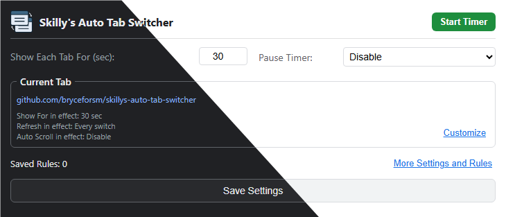

# Skilly's Auto Tab Switcher

This extension automatically switches between your open tabs at an interval you set, and it can even refresh them for you. It's designed to only work in the window where you start it, so you can keep using other windows without any interruptions. This can be great for dashboards, monitoring tools, or presentations where you need to cycle through different information displays.

**Compatibility:** Since it's built for Chrome, it works with all Chromium-based browsers like **Google Chrome**, **Microsoft Edge**, **Brave**, **Vivaldi**, and **Opera**.

**Why another tab rotator?** There are plenty of auto tab rotators on the Chrome Web Store and the other browser extension stores, but every one I tried was missing something I wanted. So I started from a fork of [ethanwa/ChromeAutoTabSwitcherExtension](https://github.com/ethanwa/ChromeAutoTabSwitcherExtension) and built it into something I could actually use day to day.

  

## Features

- **Auto Tab Switching:** Cycles through all open tabs in the window.
- **Per-Page Rules:** Override how long the page is shown, refresh and auto scroll for a whole site or a single page. Refresh can happen every switch, never, only when older than N minutes, or periodically in the background so the page is already fresh when shown.
- **Window Isolation:** Works only on the window where it was activated.
- **Auto Scroll:** Automatically scrolls down the page at a configurable speed.
- **Pause Modes:** Configurable options to pause the timer on user activity or when hovering over the page.
- **Auto-Start:** Automatically starts the timer when the browser opens or a new window is created.
- **Customizable Timing:** Set how many seconds each tab is shown, with longer or shorter times for individual sites or pages.
- **Visual Countdown:** Shows a countdown badge on the extension icon.
- **Customizable Badge:** Change the color of the badge or hide it completely.

## Usage

1.  **Popup:**
    - Click the extension icon to open the popup.
    - Set **Show Each Tab For** in seconds (minimum 5).
    - Select **Pause Timer** mode: Disable, On activity, or On hover.
    - **Current Tab** shows the site or page open in the active tab and the settings in effect for it. Click **Customize** to give it its own rule (pages that already have a rule open the editor straight away):
        - **Apply To** picks the whole site or this page only. A page rule beats a site rule, and each setting is resolved separately, so a page can override scrolling while still using its site's refresh rule.
        - **Show For** keeps this site or page on screen for a custom number of seconds before switching, instead of **Show Each Tab For**.
        - **Refresh** and **Auto Scroll** each have a **Use default** option. Auto Scroll **Enable** shows its own scroll-to-top, delay and speed settings, and **Disable** turns scrolling off for that page.
    - Click **Save Settings**.
    - Click **Start Timer** to begin rotating through the tabs in this window. The button turns red while the timer runs. Click **Stop Timer** to stop.

2.  **More Settings and Rules:**
    - Click **More Settings and Rules** in the popup, or right-click the extension icon and choose **Options**. Changes on this page save as soon as you make them.
    - **General:**
        - **Auto Start on Browser Launch** starts the timer when the browser opens (also applies to new windows).
        - **Full Screen on Timer Start** puts the window in full screen when its timer starts. Stopping the timer restores the previous window size. Press **F11** to leave full screen at any time (the extension icon is hidden while in full screen).
        - **Countdown Badge** shows the seconds until the next switch on the extension icon, in the color you pick.
        - **Theme** chooses **System** (default, follows your OS light or dark setting), **Light**, or **Dark**.
    - **Default Refresh** sets how pages without their own rule are refreshed:
        - **Disable:** never reload.
        - **Every switch:** reload each time the tab is shown.
        - **On switch, if older than N min:** reload when shown, but only if the page was last loaded more than N minutes ago.
        - **Periodically, in background:** reload hidden tabs every N minutes so they are ready when shown, and on switch if the page is older than N minutes.
    - **Default Auto Scroll** applies to pages without their own scroll rule. Set **Auto Scroll** to **Enable** to show **Scroll to Top on Switch**, **Scroll Delay** (seconds) and **Scroll Speed** (1-100).
    - **Rules** lists every rule, with a filter box and buttons to edit or remove each one. Rules are listed A to Z, and clicking a column heading sorts by that column (click again to reverse). Click a rule's site or URL to open it in a new tab. Editing also lets you change the site or page URL a rule applies to, and **Add Rule** creates a new site or page rule without visiting the page. **Export** saves every rule to a `.json` file, and **Import** adds the rules from such a file (rules for the same site or page are replaced, others are kept). Tick **Include Defaults** to also export and import **Show Each Tab For**, **Default Refresh** and **Default Auto Scroll**.
    - **Reset to Defaults** asks for confirmation and then restores every setting and removes all rules.

## Installation (From Source)

1.  Clone this repository.
2.  Open Chrome and go to `chrome://extensions`.
3.  Enable **Developer mode**.
4.  Click **Load unpacked** and select the extension folder.

## License

Distributed under the MIT License. See `LICENSE` for more information.
