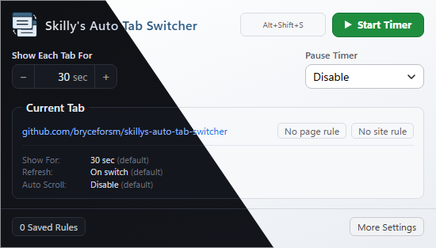
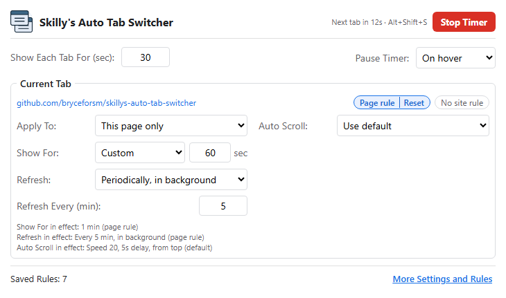
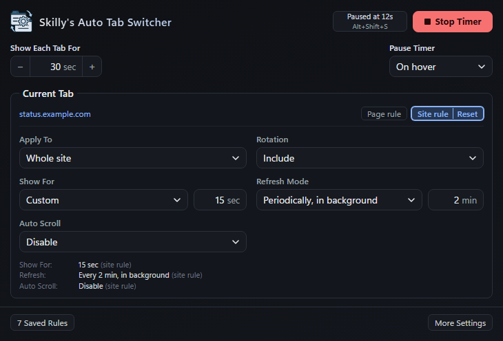
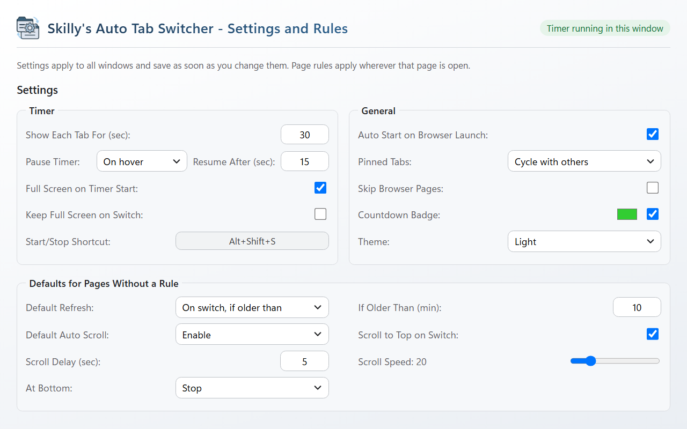
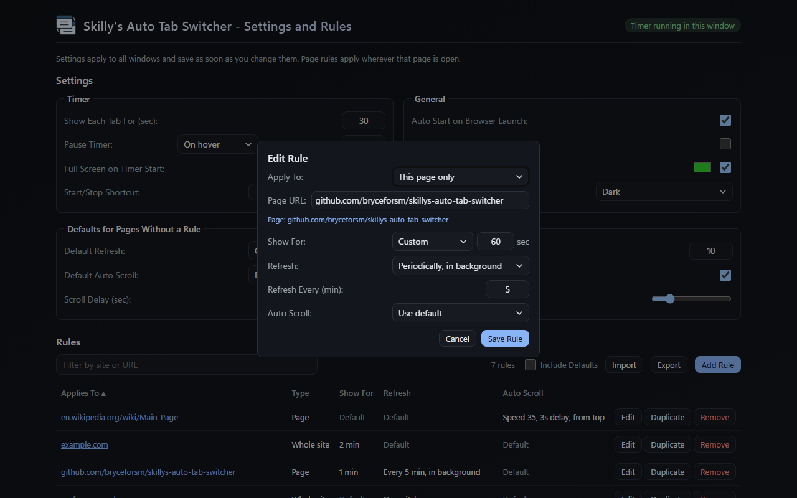

# Skilly's Auto Tab Switcher

This extension automatically switches between your open tabs at an interval you set, and it can even refresh them for you. It's designed to only work in the window where you start it, so you can keep using other windows without any interruptions. This can be great for dashboards, monitoring tools, or presentations where you need to cycle through different information displays.

  
  <!--  -->
  

**Compatibility:** Built primarily for Chrome, so it works with all Chromium-based browsers like **Google Chrome**, **Microsoft Edge**, **Brave**, **Vivaldi**, and **Opera**. **Firefox** (140 or newer) is supported too, but Chrome is the main target and gets the most testing.

**Why another tab rotator?** There are plenty of auto tab rotators/revolvers on the Chrome Web Store and the other browser extension stores, but every one I tried was missing something I wanted. So I started from a fork of [ethanwa/ChromeAutoTabSwitcherExtension](https://github.com/ethanwa/ChromeAutoTabSwitcherExtension) and built it into something I could actually use day to day.

  

## Features

- **Auto Tab Switching:** Cycles through all open tabs in the window.
- **Per-Page Rules:** Override how long the page is shown, refresh and auto scroll for a whole site or a single page. Refresh can happen on switch, before switch, never, only when older than N minutes, or periodically in the background so the page is already fresh when shown.
- **Window Isolation:** Works only on the window where it was activated.
- **Auto Scroll:** Automatically scrolls down the page at a configurable speed. Auto Scroll and On hover need site access, which is only requested when you click **Allow** on the notice that appears after you turn them on. Everything else works without it.
- **Pause Modes:** Configurable options to pause the timer on user activity or when hovering over the page.
- **Auto-Start:** Automatically starts the timer when the browser opens or a new window is created.
- **Customizable Timing:** Set how many seconds each tab is shown, with longer or shorter times for individual sites or pages.
- **Visual Countdown:** Shows a countdown badge on the extension icon.
- **Customizable Badge:** Change the color of the badge or hide it completely.

## Privacy

No accounts, no tracking and no data collection. Settings and rules stay in your browser and are never sent anywhere. Chrome describes the `tabs` permission as "Read your browsing history", but the extension has no access to your history. It only reads the addresses of your open tabs to match your page and site rules, and it never stores or sends them.

## Screenshots

<table align="center">
  <tr>
    <td align="center"> Popup with a page rule, running</td>
    <td align="center"> Same popup in the dark theme</td>
  </tr>
</table>

   
  More Settings and Rules

   
  Editing a rule, dark theme

## Usage

1.  **Popup:**
    - Click the extension icon to open the popup. Changes save as soon as you make them.
    - Set **Show Each Tab For** in seconds (minimum 5).
    - Select **Pause Timer** mode: Disable, On activity, or On hover. On hover also pauses while this popup is open. On hover can't detect the pointer on pages where Chrome blocks extensions, such as `chrome://` pages, the Chrome Web Store and the new tab page. Use On activity there.
    - **Current Tab** shows the site or page open in the active tab and the settings in effect for it, each marked **page rule**, **site rule** or **default**. Next to the address, **Page rule** and **Site rule** light up when this page or its whole site has a rule. Click **Reset** on either one to remove that rule and go back to the defaults (click **Undo** if you change your mind). Click **Page rule** or **Site rule** to open the editor for that scope and give it its own rule (the editor always starts collapsed):
        - **Apply To** picks the whole site or this page only. A page rule beats a site rule, and each setting is resolved separately, so a page can override scrolling while still using its site's refresh rule.
        - **Show For** keeps this site or page on screen for a custom number of seconds before switching, instead of **Show Each Tab For**.
        - **Refresh** and **Auto Scroll** each have a **Use default** option. Auto Scroll **Enable** shows its own scroll-to-top, delay and speed settings, and **Disable** turns scrolling off for that page.
    - Click **Start Timer** to begin rotating through the tabs in this window. The button turns red while the timer runs. Click **Stop Timer** to stop. The keyboard shortcut is shown to the left of the button.
    - **Keyboard shortcut:** press **Alt+Shift+S** (**Control+Shift+S** on Mac) to start or stop the timer in the current window. To change it, open `chrome://extensions/shortcuts` (`edge://extensions/shortcuts` in Edge).

2.  **More Settings and Rules:**
    - Click **Saved Rules** or **More Settings** in the popup, or right-click the extension icon and choose **Options**. Clicking either in the popup stops the timer in that window so the settings tab stays on screen. The top of the page shows whether the timer is running in its window. Changes on this page save as soon as you make them.
    - **Timer:**
        - **Show Each Tab For** and **Pause Timer** are the same settings as in the popup.
        - **Resume After** (shown next to Pause Timer when it is On activity or On hover) is how many seconds before the timer resumes. With **On activity** it is the time without mouse or keyboard use (at least 15, a Chrome limit). With **On hover** it is the time after the pointer leaves the page (at least 1).
        - **Start/Stop Shortcut** shows the current keyboard shortcut. Click it to change it in the browser's shortcut settings.
        - **Full Screen on Timer Start** puts the window in full screen when its timer starts. Stopping the timer restores the previous window size. Press **F11** to leave full screen at any time (the extension icon is hidden while in full screen).
    - **General:**
        - **Auto Start on Browser Launch** starts the timer when the browser opens (also applies to new windows).
        - **Pinned Tabs** can cycle pinned tabs with the others, skip them, or rotate only through them.
        - **Countdown Badge** shows the seconds until the next switch on the extension icon, in the color you pick.
        - **Theme** chooses **System** (default, follows your OS light or dark setting), **Light**, or **Dark**.
    - **Defaults for Pages Without a Rule:**
        - **Default Refresh** sets how pages without their own refresh rule are refreshed:
            - **Disable:** never reload.
            - **On switch:** reload each time the tab is shown.
            - **Before switch:** reload the next tab about 5 seconds before its turn, so it is already fresh when shown. Tabs that were not reloaded early are reloaded on switch.
            - **On switch, if older than N min:** reload when shown, but only if the page was last loaded more than N minutes ago.
            - **Periodically, in background:** reload hidden tabs every N minutes so they are ready when shown, and on switch if the page is older than N minutes.
        - **Default Auto Scroll** applies to pages without their own scroll rule. Set it to **Enable** to show **Scroll to Top on Switch**, **Scroll Delay** (seconds) and **Scroll Speed** (1-100).
    - **Rules** lists every rule, with a filter box and buttons to edit or remove each one. Rules are listed A to Z, and clicking a column heading sorts by that column (click again to reverse). Click a rule's site or URL to open it in a new tab. Editing also lets you change the site or page URL a rule applies to, and **Add Rule** creates a new site or page rule without visiting the page. **Duplicate** opens a new rule with the same settings, ready for a different site or page. **Export** saves every rule to a `.json` file, and **Import** adds the rules from such a file (rules for the same site or page are replaced, others are kept). Tick **Include Defaults** to also export and import **Show Each Tab For**, **Default Refresh** and **Default Auto Scroll**.
    - **Reset to Defaults** asks for confirmation and then restores every setting and removes all rules. The keyboard shortcut is not changed.

## Installation (From Source)

1.  Clone this repository.
2.  Open Chrome and go to `chrome://extensions`.
3.  Enable **Developer mode**.
4.  Click **Load unpacked** and select the extension folder.

### Firefox

Firefox needs a different manifest, so run `.\Build-Package.ps1` and use the `_firefox.zip` it writes. Go to `about:debugging`, choose **This Firefox**, click **Load Temporary Add-on** and pick the zip. Firefox 140 or newer is required.

## License

Distributed under the MIT License. See `LICENSE` for more information.
