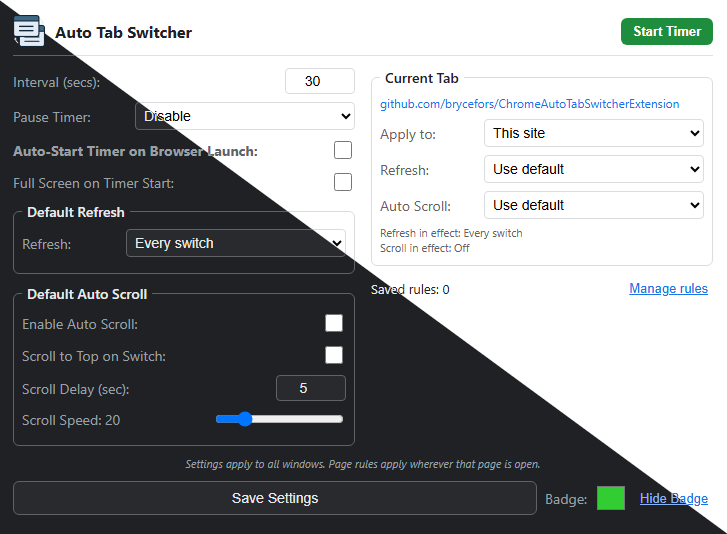

# Auto Tab Switcher Extension

This extension automatically switches between your open tabs at an interval you set, and it can even refresh them for you. It's designed to only work in the window where you start it, so you can keep using other windows without any interruptions. This can be great for dashboards, monitoring tools, or presentations where you need to cycle through different information displays. Since **Revolver - Tabs** is no longer available, this plugin acts as a functional alternative.

**Compatibility:** Since it's built for Chrome, it works with all Chromium-based browsers like **Google Chrome**, **Microsoft Edge**, **Brave**, **Vivaldi**, and **Opera**.

This project is forked from [ethanwa/ChromeAutoTabSwitcherExtension](https://github.com/ethanwa/ChromeAutoTabSwitcherExtension).

  

## Features

- **Auto Tab Switching:** Cycles through all open tabs in the window.
- **Per-Page Rules:** Override refresh and auto scroll for a whole site or a single page. Refresh can happen every switch, never, only when older than N minutes, or periodically in the background so the page is already fresh when shown.
- **Window Isolation:** Works only on the window where it was activated.
- **Auto Scroll:** Automatically scrolls down the page at a configurable speed.
- **Pause Modes:** Configurable options to pause the timer on user activity or when hovering over the page.
- **Auto-Start:** Automatically starts the timer when the browser opens or a new window is created.
- **Customizable Interval:** Set the switching time in seconds.
- **Visual Countdown:** Shows a countdown badge on the extension icon.
- **Customizable Badge:** Change the color of the badge or hide it completely.

## Usage

1.  **Configure Settings:**
    - Open the extension popup.
    - Set the **Interval** in seconds (minimum 5).
    - Select **Pause Timer** mode: Disable, On Activity, or On Hover.
    - Toggle **Auto-Start Timer on Browser Launch** if desired (also applies to new windows).
    - **Default Refresh** sets how pages without their own rule are refreshed. Refresh modes:
        - **Every switch:** reload each time the tab is shown.
        - **Never:** never reload.
        - **On switch, if older than N min:** reload when shown, but only if the page was last loaded more than N minutes ago.
        - **Periodically, even in background:** reload hidden tabs every N minutes so they are ready when shown, and on switch if the page is older than N minutes.
    - **Default Auto Scroll** applies to pages without their own scroll rule:
        - Toggle **Enable Auto Scroll** to start scrolling automatically.
        - Toggle **Scroll to Top on Switch** to reset scroll position when switching tabs.
        - Set **Scroll Delay** (seconds) to wait before scrolling starts.
        - Adjust **Scroll Speed** slider (1-100).
    - **Current Tab** creates a rule for the site or exact page open in the active tab:
        - **Apply to** picks the whole site or this page only. A page rule beats a site rule, and each setting is resolved separately, so a page can override scrolling while still using its site's refresh rule.
        - **Refresh** and **Auto Scroll** each have a **Use default** option. Auto Scroll **On** shows its own scroll-to-top, delay and speed settings, and **Off** disables scrolling for that page.
        - The lines underneath show which refresh and scroll settings are in effect for the tab.
    - **Manage rules** (next to the saved rule count) opens a full page listing every rule, with a filter box and buttons to edit or remove each one. It is also available from **Options** when you right-click the extension icon. That page also has **Reset to defaults**, which asks for confirmation and then restores every setting and removes all rules.
    - Choose a **Badge** color.
    - Click **Save Settings**.

2.  **Control Timer:**
    - Click **Start Timer** to begin rotating through the current open tabs. The button will turn red to indicate the timer is running.
    - Click **Stop Timer** to stop the tabs from switching.

3.  **Badge Visibility:**
    - Click the **Hide/Show Badge** button to toggle the countdown display.

## Installation (From Source)

1.  Clone this repository.
2.  Open Chrome and go to `chrome://extensions`.
3.  Enable **Developer mode**.
4.  Click **Load unpacked** and select the extension folder.

## License

Distributed under the MIT License. See `LICENSE` for more information.
